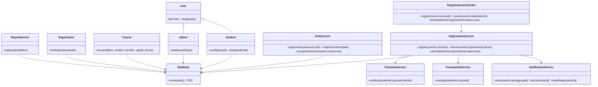

# CampusCourse — Online Course Registration System

A server-rendered college course registration application built with PHP 8.1+, object-oriented PHP, PDO, MySQL/MariaDB, HTML, Bootstrap 5, and vanilla JavaScript. No framework or Node.js build step is required.

## Install with XAMPP

1. Copy this project folder to `C:\xampp\htdocs\online_course_registration\`.
2. Start **Apache** and **MySQL** from the XAMPP Control Panel.
3. Open `http://localhost/phpmyadmin/`, choose **Import**, select `database.sql`, then click **Import**. The script creates `online_course_registration` and sample departments, a current term, and courses.
4. If your local MySQL settings differ from XAMPP defaults, set `DB_HOST`, `DB_NAME`, `DB_USER`, and `DB_PASS` in the Apache/PHP environment. The defaults in `config/Database.php` are `127.0.0.1`, `online_course_registration`, `root`, and an empty password. Set `APP_URL` if you install under a different URL path.
5. Open `http://localhost/online_course_registration/setup.php` and create the first administrator. Setup is disabled once any administrator exists. The one-time setup also creates a demo student account.
6. Sign in at `http://localhost/online_course_registration/auth/login.php`.

To add or refresh the additional sample catalog on an installation that already has data, import `demo_courses.sql` into the existing database. Unlike `database.sql`, this supplemental seed does **not** drop or recreate the database; it adds 16 courses across semesters 1, 2, and 4 with meeting times and prerequisite examples.

The administrator credential is the email and password entered during first-run setup. Demo student:

| Account | Value |
|---|---|
| Email | `demo.student@college.test` |
| Password | `DemoStudent!2026` |
| Register number | `DEMO2026` |

Change the demo password after first sign-in using **Change password**. The fixed demo credential is for a local classroom demo only; do not expose this installation publicly. Students can also create accounts from **Create student account**.

Bootstrap, Bootstrap Icons, and Chart.js are loaded from jsDelivr, so those presentation assets require an internet connection unless replaced with local copies.

## Project structure

```text
admin/                 Administrator dashboards, course/student/term/record management, reports
assets/css, assets/js  Responsive theme and small interaction helpers
auth/                  Login, student registration, logout, password change
classes/               User, Student, Admin, Course, Registration models
config/                Application settings and PDO connection
controllers/           Request orchestration
includes/              Shared layout and safe output/CSRF/redirect helpers
middleware/            Autoloading, session initialization, shared bootstrap
services/              Authentication, registration, schedule, prerequisite, notification, report rules
student/               Student dashboard, catalog, timetable, history, profile, notifications
database.sql           Schema, constraints, indexes, and starter catalog data
setup.php              First-administrator and demo-student setup
```

## Registration behavior

- A registration request is stored as `pending`; pending and approved requests reserve seats.
- The student catalog displays all active courses and labels department/semester eligibility; the registration service still rejects ineligible requests server-side.
- A unique key on `(student_id, course_id, term_id)` and a transaction prevent duplicate registrations.
- The service locks the student's row and course row before checking eligibility and capacity. Registration checks the current term window, active course, department/semester, remaining capacity, completed prerequisites, same-day time overlap, and the term credit limit.
- Cancellation is allowed to students through the registration deadline. An administrator can cancel at any time. Cancelled/rejected records no longer reserve seats; registration history remains in the database. A course/term pair may have only one registration row per student, including after cancellation.
- Grades `F`, `NC`, `W`, and `I` do not satisfy prerequisites; other recorded grades do.
- Admin edits cannot lower a course's capacity below its active registrations in the current term.

## Security and configuration

Passwords use PHP's `password_hash()`/`password_verify()`. Sessions use strict mode, HTTP-only/SameSite cookies and are regenerated after login. Protected pages check the active database account and role. Forms that change state require a session CSRF token; output is escaped with `htmlspecialchars`; user-supplied SQL values are bound through PDO prepared statements. Login failures are rate-limited per normalized email/IP hash. Registration state changes, profile changes, course changes, and account administration are recorded in `audit_logs`.

Credentials are configurable through environment variables (avoid committing real credentials). Change the XAMPP MySQL root password for any non-local deployment and serve the application only over HTTPS outside localhost.

## OOAD diagrams

### Class diagram



### Registration sequence

```mermaid
sequenceDiagram
    actor Student
    participant Page as Student registration endpoint
    participant Controller as RegistrationController
    participant Service as RegistrationService
    participant DB as MySQL/InnoDB
    participant Checks as Schedule/Prerequisite services
    participant Notify as NotificationService
    Student->>Page: POST course_id + CSRF token
    Page->>Controller: register(authenticated user, course)
    Controller->>Service: register(user, course)
    Service->>DB: BEGIN; lock student and course rows
    Service->>DB: Validate active term, eligibility, duplicate, capacity, credits
    Service->>Checks: Check passed prerequisites and time overlaps
    Checks->>DB: Prepared SELECT queries
    Service->>DB: Insert pending request (unique student/course/term key)
    Service->>Notify: Notify student and active administrators
    Service->>DB: Write audit event; COMMIT
    Service-->>Student: Success message or validation error
```

## Verification checklist

Import the included data and create the initial admin and demo student before running these checks:

| Test | Steps | Expected result |
|---|---|---|
| PDO/database connection | Open the landing page and sign in | Pages render against MySQL; database errors are not replaced by fake data |
| Student registration | Create an account with a unique email/register number | Student profile and user are created; password is hashed |
| Login/logout | Sign in as student/admin, then sign out | Role dashboard loads; logout requires POST and CSRF |
| Role authorization | Sign in as student and request `/admin/index.php` | HTTP 403; admin data is not rendered |
| Course CRUD | As admin add a course with schedule/prerequisite; edit it; deactivate/reactivate | Values persist and course availability follows active status |
| Eligible registration | As eligible student request a course during the current term | One pending request is stored and a seat is reserved |
| Duplicate request | Submit the same course request again | Request is rejected by server validation/database uniqueness |
| Capacity | Fill course capacity (or temporarily set it to one); request from another eligible student | Full-course request is rejected without over-enrollment |
| Prerequisites | Add a prerequisite to a course; request it without a passing academic record, then add a passing record in Admin → Academic records | First request is rejected; request after completion passes that check |
| Timetable conflict | Give two eligible courses overlapping times on the same weekday; register the first, then request the second | Second request is rejected; non-overlapping meeting times are accepted |
| Credit limit | Set a low current-term credit limit and request courses over that limit | Request exceeding the configured limit is rejected |
| Registration window | Move the current term's registration start/end around the current time | Requests outside the window are rejected |
| Approval/rejection | Approve and reject pending requests from admin registrations | Status and student notification update; rejected request releases its seat |
| Cancellation | Cancel a pending/approved request before deadline; test as admin after deadline | Student cancellation is deadline-limited; admin can cancel; seat is released |
| Reports/CSV | Filter reports and download CSV; inspect values beginning with `=`, `+`, `-`, or `@` | Filters apply and spreadsheet-formula values are neutralized |
| Course management | Search courses/students, edit student/department/term, set active term | Search and settings persist in MySQL |
| Password/CSRF | Change password; submit a state-changing form without or with stale token | Password changes after current-password validation; invalid CSRF is rejected |

To run the browser workflow, visit each route from its dashboard; no test-only account or seeded registration data is required. The demo account begins with no registrations, which lets you verify the registration path directly.
# Campus-Course-Management-System

# Campus-Course-Management-System

